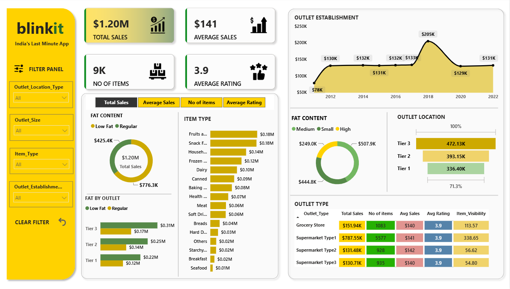

# 🛒 Blinkit Sales Analysis Dashboard | Power BI

**Interactive Blinkit sales analysis dashboard built using Microsoft Power BI, DAX, and Power Query.**

## 📌 Project Overview

The Blinkit Sales Analysis Dashboard is a Business Intelligence project developed using Microsoft Power BI to analyze sales performance, product categories, outlet locations, outlet sizes, and customer ratings.

The dashboard transforms sales data into interactive visualizations and key performance indicators (KPIs), helping users understand business performance and identify opportunities for improvement.

## 🎯 Business Objectives

- Analyze overall sales performance and revenue.
- Evaluate the impact of product fat content on sales.
- Identify top-performing item categories.
- Compare sales performance across outlet sizes and locations.
- Analyze sales trends based on outlet establishment year.
- Compare key business metrics across outlet types.
- Support data-driven business decisions through interactive reporting.

## 📊 Dashboard Preview



## 📈 Key Performance Indicators (KPIs)

| KPI | Value | Description |
|---|---:|---|
| 💰 Total Sales | $1.20M | Overall sales revenue |
| 🧾 Average Sales | $141 | Average sales value |
| 📦 Number of Items | 9K | Total items sold |
| ⭐ Average Rating | 3.9 | Average customer rating |

*Note: KPI values may change based on the selected filters.*

## 📉 Dashboard Visualizations

### 1️⃣ Total Sales by Fat Content
**Chart Type:** Donut Chart

- Compares sales generated by low-fat and regular-fat products.
- Helps understand the contribution of different fat-content categories to total sales.

### 2️⃣ Total Sales by Item Type
**Chart Type:** Bar Chart

- Compares sales across product categories.
- Helps identify high-performing and low-performing item types.

### 3️⃣ Fat Content by Outlet for Total Sales
**Chart Type:** Stacked Column Chart

- Analyzes sales by fat content across outlet tiers.
- Helps compare product-category performance across different outlets.

### 4️⃣ Total Sales by Outlet Establishment
**Chart Type:** Line Chart

- Displays sales trends according to outlet establishment year.
- Helps explore how outlet establishment periods relate to sales performance.

### 5️⃣ Sales by Outlet Size
**Chart Type:** Donut Chart

- Compares sales contributions from different outlet sizes.
- Helps evaluate the relationship between outlet size and sales.

### 6️⃣ Sales by Outlet Location
**Chart Type:** Funnel-Style Visualization

- Compares sales distribution across Tier 1, Tier 2, and Tier 3 locations.
- Helps identify differences in geographic sales performance.

### 7️⃣ All Metrics by Outlet Type
**Chart Type:** Table / Matrix

Compares multiple KPIs across outlet types, including:

- Total Sales
- Number of Items
- Average Sales
- Average Rating
- Item Visibility

This view provides a consolidated comparison of outlet performance.

## 🛠️ Tools & Technologies

- **Microsoft Power BI Desktop** – Dashboard development and data visualization
- **Power Query** – Data cleaning and transformation
- **DAX (Data Analysis Expressions)** – KPI calculations and analytical measures
- **Data Modeling** – Organizing data for reporting
- **Excel / CSV** – Data source, depending on the dataset used

## 🔄 Project Workflow

1. 📋 Requirement Gathering and Business Understanding
2. 🔍 Data Exploration and Walkthrough
3. 🔗 Data Connection and Import
4. 🧹 Data Cleaning and Quality Checks
5. 🗂️ Data Modeling
6. ⚙️ Data Transformation and Processing
7. 🧮 DAX Calculations and KPI Development
8. 🎨 Dashboard Layout Design
9. 📊 Chart Development and Formatting
10. 📈 Dashboard Development
11. 💡 Business Insights Generation

## 🎛️ Interactive Features

- Outlet location type filtering
- Outlet size filtering
- Item type filtering
- Outlet establishment year analysis
- Interactive KPI and chart exploration
- Cross-filtering between visuals, where configured

## 💡 Business Insights

The dashboard enables users to investigate questions such as:

- Which item categories contribute most to total sales?
- How do low-fat and regular-fat products compare in sales?
- Which outlet tiers contribute the most revenue?
- How do sales contributions vary by outlet size?
- How does sales performance vary by outlet establishment year?
- Which outlet types perform best across the selected KPIs?

These analyses can support sales monitoring, product assortment planning, outlet performance evaluation, and inventory-related decisions.

## 🚀 How to Use the Project

1. Clone or download this repository.
2. Open the `.pbix` file using Microsoft Power BI Desktop.
3. Update the data source path if required.
4. Refresh the dataset if the original data source is available.
5. Interact with the filters and visualizations to explore sales performance.

## 📁 Repository Structure

```text
Blinkit-Sales-Analysis-Power-BI/
│
├── README.md
├── Blinkit_Sales_Analysis.pbix
└── dashboard.png
```


## 🎓 Skills Demonstrated

- Data Cleaning and Transformation
- Power Query
- DAX Measures and KPI Calculations
- Data Modeling
- Interactive Dashboard Development
- Business Intelligence and Reporting
- Data Visualization
- Business Performance Analysis

## 👨‍💻 Author

**Santhosh Kumar D**

Data Analyst | BI Analyst

**Technical Skills:** Power BI | SQL | Excel | DAX | Power Query | Data Visualization

## ⭐ Acknowledgements

This project was developed for learning and demonstrating practical Business Intelligence and data analytics skills using Microsoft Power BI.

---

⭐ If you find this project useful, consider giving this repository a star!
